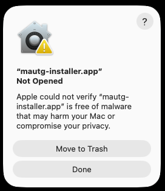
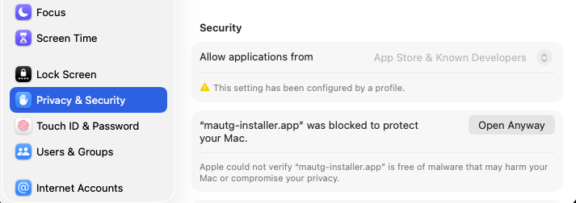
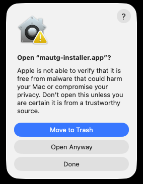
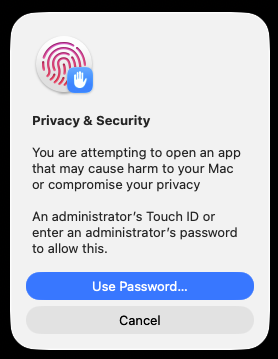
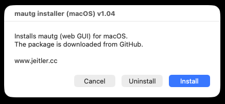
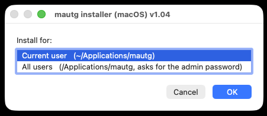
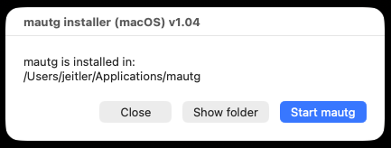

# mautg for macOS

Web GUI version of [mautg](https://github.com/ewaldj/mautg) for macOS 10.13+ (Apple Silicon and Intel).
A small launcher app (`mautg.app`) starts mautg in the background, opens the web GUI and shows a window with
Start / Stop / Restart / port / Open web GUI / Console log / Admin setup / Update. Same functions as the Windows version.
Python 3.11 (Apple Silicon and Intel) is included.

## Options

The window has the checkboxes **Disable autostart** (mautg is not started with the launcher, press Start) and **Disable Config** (start without `~/.mau/config.json`, option `--no-config`) and the field **CLI options** (any mautg options, e.g. `-bind 0.0.0.0`). All are applied with Start / Restart and stored in `mautg-args.txt` next to the program.

> **Alpha status:** hardly tested, reduced function compared to the Linux version (see the main [README](https://github.com/ewaldj/mautg#platform-status)). Expect bugs.
> macOS: no kernel RX timestamps (user-space delay), no per-socket drop counter, no DF bit, TCP algorithm system-wide, TCP window / queue values missing.

## Download

| Variant | File | Use |
|---|---|---|
| Installer | [mautg-installer-mac.zip](https://github.com/ewaldj/mautg/raw/main/OSX_Version/mautg-installer-mac.zip) | Unzip, open `mautg-installer.app`: downloads the package and installs it for the current user or all users |
| Portable | [mautg-mac.zip](https://github.com/ewaldj/mautg/raw/main/OSX_Version/mautg-mac.zip) | Unzip anywhere and open `mautg.app` |

## Installation with the installer

The apps are not signed with an Apple Developer ID, so macOS blocks them on the first start after a browser download. This is done once per downloaded app.

1. Download [mautg-installer-mac.zip](https://github.com/ewaldj/mautg/raw/main/OSX_Version/mautg-installer-mac.zip), unzip it and open `mautg-installer.app` (double-click). macOS shows *Not Opened*: press **Done**.

   

2. Open *System Settings / Privacy & Security*, scroll to *Security* and press **Open Anyway** next to the blocked app (shown for about an hour after the attempt).

   

3. Press **Open Anyway** in the dialog and confirm with Touch ID or the administrator password.

    

4. The installer window opens: press **Install**. (**Uninstall** removes mautg again.)

   

5. Choose *Current user* (`~/Applications/mautg`) or *All users* (`/Applications/mautg`, asks for the administrator password) and press **OK**. The package is downloaded from GitHub and installed.

   

6. Press **Start mautg**: mautg starts in the background and the web GUI opens in the browser. **Show folder** opens the installation folder.

   

The installer removes the quarantine flag from the installed files itself, so `mautg.app` starts without these steps. Without them the icon only bounces and nothing appears.
If the installer window does not appear, the reason is written to `~/Library/Logs/mautg-installer.log`.

### Alternatives for the first start

- Download in Terminal (curl sets no quarantine flag):

  ```sh
  cd ~/Downloads && curl -fLO https://github.com/ewaldj/mautg/raw/main/OSX_Version/mautg-installer-mac.zip && unzip -oq mautg-installer-mac.zip && open mautg-installer.app
  ```

- Remove the flag from a browser download (Terminal needs *App Management* in Privacy & Security): `xattr -dr com.apple.quarantine mautg-installer.app` (or the `mautg-mac` folder).
- The portable `mautg-mac.zip` needs the same steps for `mautg.app`.
- Unzip into a new, empty folder: macOS remembers an earlier app at the same path and may report *The file can't be found*.

## Admin setup (optional)

mautg always runs as your user. The launcher can raise `net.inet.udp.maxdgram` to 65535 (default 9216 limits large packets; until the next reboot)
and, if the macOS firewall is on, allow the bundled Python. This asks for the administrator password; asked once at first start, "Never ask" is remembered
(`~/Library/Application Support/mautg/admin-ask-off`).

## Update

The launcher checks `mversions` on GitHub at start and every 6 hours. If `mautg.py` is newer, the Update button replaces it;
if `mautg-mac` is newer, the whole package is replaced.

## Notes

- The web GUI listens on 127.0.0.1 only; add `-bind 0.0.0.0` to `mautg-args.txt` to reach it from the network.
- Terminal mode: run `mautg.py` directly in Terminal.
- Details: <https://www.jeitler.cc>
