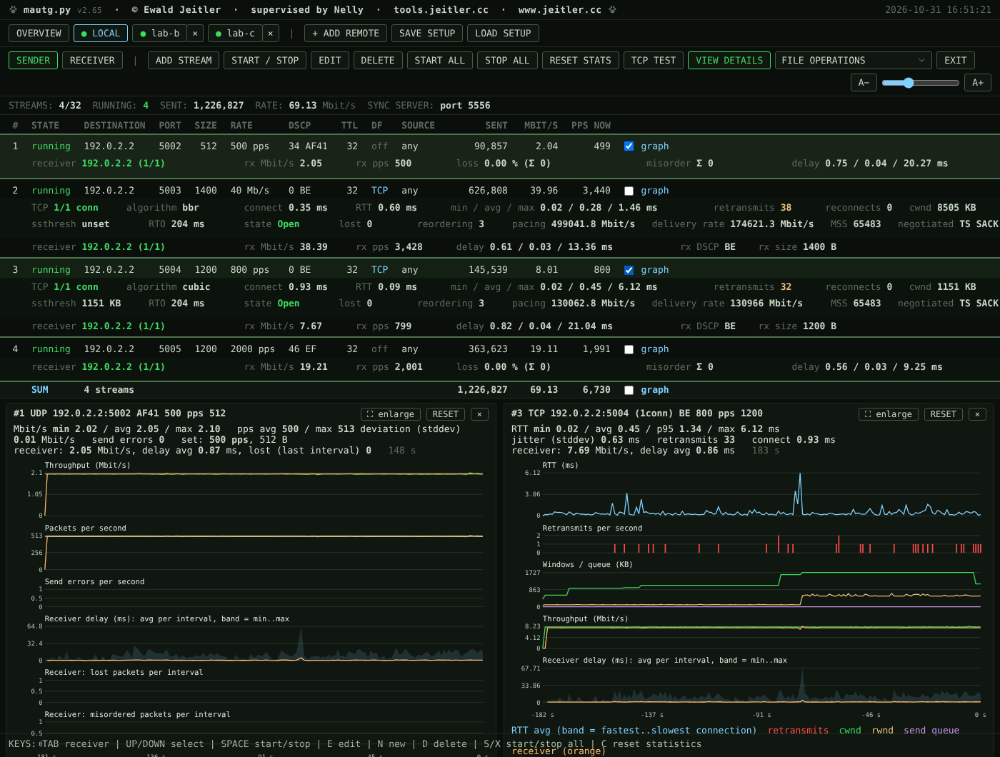
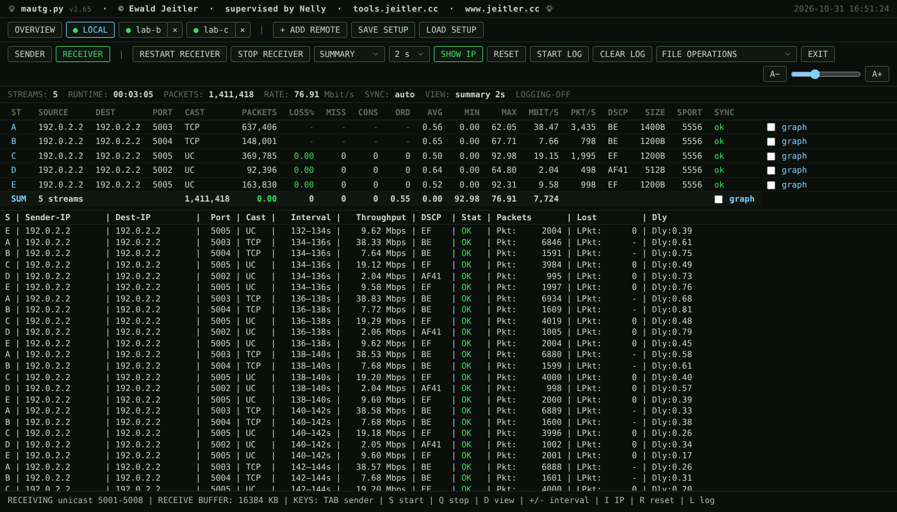
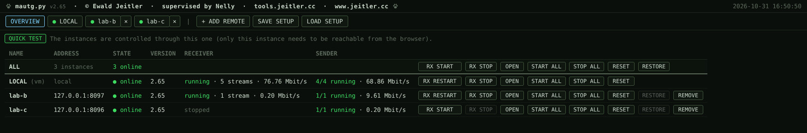
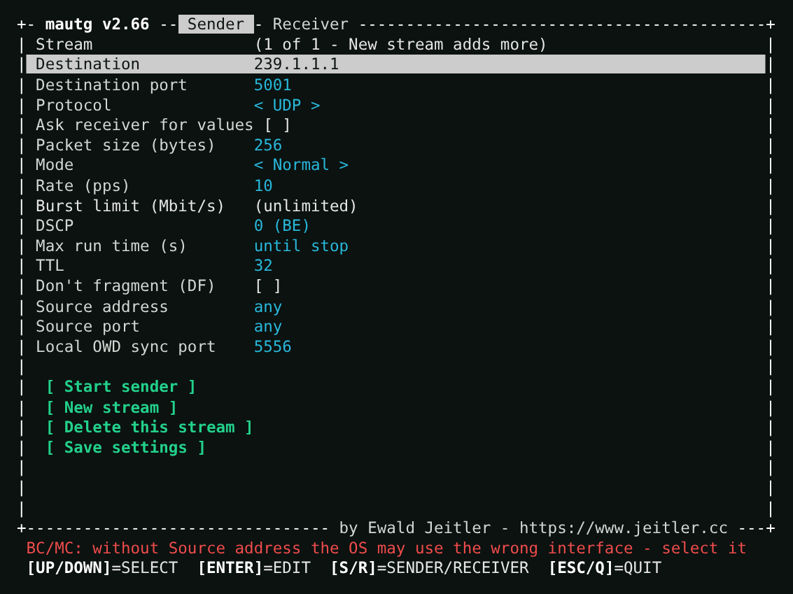
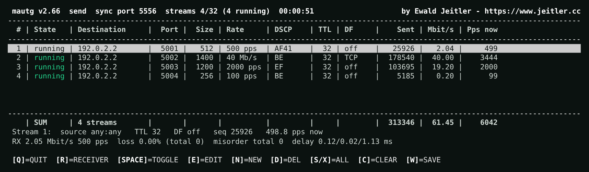
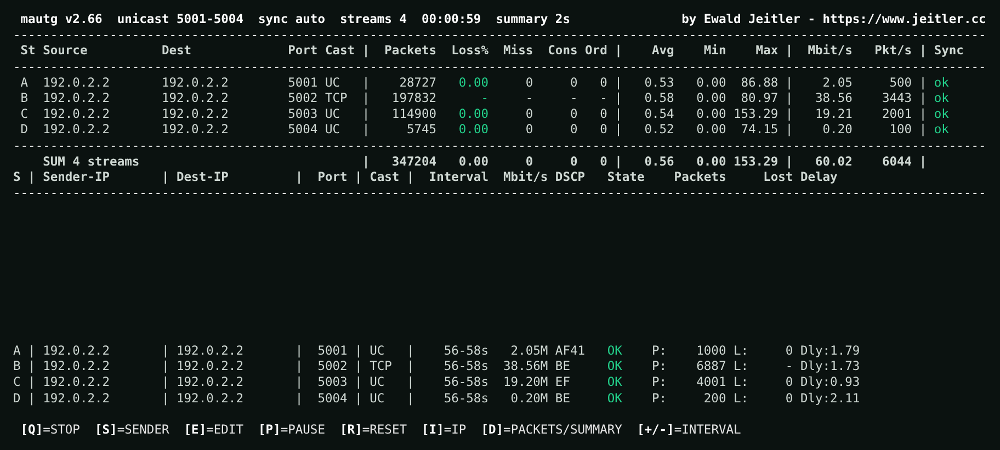

# MAU — Multicast/AND/Unicast Traffic Generator & Analyzer

Single-file Python tool (standard library only) for UDP and TCP traffic generation and analysis: one-way delay (OWD), loss, misorder, DSCP, throughput. **Sender** and **receiver** run in one program, controlled from the browser (web GUI), from a full-screen text UI, or by sub-command.

By Ewald Jeitler - https://www.jeitler.cc



## Features

- Multicast, unicast, broadcast; up to 32 sender streams, 36 receiver streams; UDP and TCP (parallel connections, kernel TCP statistics, congestion control, traffic patterns, slow reader, step / algorithm / bufferbloat tests)
- OWD with NTP-style time sync and kernel RX timestamps (Linux); per stream loss, longest loss run, misorder, duplicates, DSCP, Mbit/s, pkt/s, delay avg/min/max
- Receiver query: the sender shows the values that arrive at the receiver (also in its graphs)
- Per-stream max run time, burst mode, DSCP, TTL, DF, source address / port
- Web GUI with live graphs, tooltips on every field, file operations, CSV log
- Remote control: one web GUI controls other mautg instances, installs / updates them over SSH, saves setups
- Receiver overload detection, Wireshark dissectors (UDP + TCP, any port)
- Python 3.6.1+ (also Cisco IOS-XE Guest Shell)

## Installation / Update

```
/bin/bash -c "$(curl -fsSL https://raw.githubusercontent.com/ewaldj/mautg/main/e-install.sh)"
```

Installs `mautg.py` to `/usr/local/bin` as `mautg`; running it again updates. Manual: download `mautg.py`, `chmod +x mautg.py`.

| Platform | Status |
|---|---|
| Linux (incl. Raspberry Pi OS) | Full function, main test platform |
| macOS, Windows | **Alpha**: launcher packages below; no kernel RX timestamps, reduced TCP values, Windows: no RX-drop detection, DSCP only as administrator |

## Web GUI

```bash
./mautg.py -web                 # http://<host>:8081/  (receiver and sender in the browser)
./mautg.py -web -port 8090 -bind 127.0.0.1
```

| Option | Effect |
|---|---|
| `-web` | Web GUI instead of the terminal UI; `send ... -web` / `recv ... -web` start streams / receiver with the given options |
| `-wv` / `-wvc` | Terminal run plus read-only web view / web view that can also control the run |
| `-port N`, `-bind ADDR` | HTTP port (default 8081), bind address (default `0.0.0.0`) |

- **Sender tab:** stream table with `SUM` row; add / edit streams, start / stop, `VIEW DETAILS` (TCP values, receiver query values), `TCP TEST`, a graph per stream (15 min, `enlarge`).
- **Receiver tab:** stream table (source, destination, cast, loss, delay, DSCP, ...), log, settings dialog, CSV log.
- **FILE OPERATIONS:** save / load config, download CSV log, up- / download files of the working directory.
- Tooltips on every field and column header. No authentication, no TLS: use `-bind 127.0.0.1` (e.g. with an SSH tunnel) in untrusted networks.
- `-web` keeps running when the terminal / SSH session ends (SIGHUP ignored).



### Remote control

One instance controls others: the strip `OVERVIEW | LOCAL | <remote> ... | + ADD REMOTE | SAVE SETUP | LOAD SETUP` shows every instance with its complete GUI; the browser only talks to the controlling instance (proxy `/r/<id>/...`). The remote runs `-web -port N` and must be reachable from the controlling instance.



- **Overview:** state, version, receiver and sender summary per instance; `RX START` / `RX STOP`, `OPEN`, `START ALL`, `STOP ALL`, `RESET`, `REMOVE`; the row `ALL` applies an action to every online instance.
- **Install / update over SSH:** `ADD REMOTE` / `INSTALL` / `UPDATE` copy `mautg.py` with the ssh client of the controlling computer and start it on the Linux host (as root with sudo: own systemd service, so it survives the end of the ssh session). `TEST SSH` changes nothing. Key / agent login or password (kept in the browser memory only, never stored). Streams and ports survive an update.
- **REMOVE:** stops the instance through the web GUI; if that fails, through SSH.
- **EXIT** (end of the strip): quits mautg on all reachable remote instances first, then on this instance; if a remote does not answer, nothing is stopped locally.
- **Setups:** `SAVE SETUP` stores the remote list and the settings of every online instance (`~/.mau/setups/`); `LOAD SETUP` / `RESTORE` applies them again.
- **QUICK TEST:** sender instance A to receiver instance B in one dialog (protocol, rate, size, DSCP, port, duration).
- Offline entries show the ICMP result (`ping ok` = host up, only mautg down).

## Text UI

```bash
./mautg.py                                          # menu (Sender / Receiver tabs)
./mautg.py send -d 239.1.1.1 -p 5001 --pps 100      # sender live view
./mautg.py recv -g 239.1.1.1 -p 5001 -i 5           # receiver live view, summary every 5 s
./mautg.py send --stream 239.1.1.1:5001,pps=100,dscp=EF --stream 10.0.0.5:5003,tcp,conn=4,burst=200
./mautg.py recv -u -p 5001-5008 -l capture.csv
```







- Menu: `Up` / `Down`, `Enter` edit, `Space` toggle, `s` / `r` Sender / Receiver tab, `Esc` leave. Sender live view: `Space` start / stop, `e` edit, `n` new, `d` delete, `s` / `x` start / stop all, `c` reset statistics, `r` receiver view. Receiver live view: `s` sender view, `e` settings, `i` IP columns, `d` per packet / summary, `+` / `-` interval, `r` reset.
- With more than one stream the receiver summary ends every interval with a `SUM` line (cyan): total Mbit/s, packets, UDP loss, delay of all streams; `MIX` as cast for mixed TCP / UDP / MC / BC / UC.
- Without root in a terminal (Linux / macOS) mautg asks `Restart with sudo?`: root allows a bigger receive buffer. `--no-sudo` / `MAUTG_NO_SUDO=1` silences it.
- Closing the terminal stops everything (exit 129 / 143): use `tmux` / `screen`. Terminal at least 60x16, else line menus.
- `--no-config` starts with the built-in defaults instead of `~/.mau/config.json`.

All options, TCP details, receiver query, pacing / overload tuning: [docs/REFERENCE.md](docs/REFERENCE.md).

## Windows / macOS (launcher)

Packages with launcher window, bundled Python and update check start `mautg.py -web` in the background and open the web GUI.

| Platform | Installer | Portable |
|---|---|---|
| Windows 10/11 x64 | [mautg-installer.exe](https://github.com/ewaldj/mautg/raw/main/Windows_Version/mautg-installer.exe) | [mautg-windows.zip](https://github.com/ewaldj/mautg/raw/main/Windows_Version/mautg-windows.zip) |
| macOS 10.13+ arm64 / x86_64 | [mautg-installer-mac.zip](https://github.com/ewaldj/mautg/raw/main/OSX_Version/mautg-installer-mac.zip) | [mautg-mac.zip](https://github.com/ewaldj/mautg/raw/main/OSX_Version/mautg-mac.zip) |

Window: Start / Stop / Restart, web port, *Disable autostart*, *Disable Config*, *CLI options*, Console log, Update, Admin, Exit. macOS apps are not notarized: the first start needs *Open Anyway* in Privacy & Security, see [macOS](OSX_Version/README.md#first-start-apps-are-not-notarized). Details: [Windows](Windows_Version/README.md), [macOS](OSX_Version/README.md).

## Protocol, files

- Data packet format, OWD sync protocol: [docs/REFERENCE.md](docs/REFERENCE.md#protocol). Wireshark dissectors: [wireshark/](wireshark/README.md).
- Config `~/.mau/config.json`; CSV log `mautg-log_<date>_<time>.csv` in the current directory.

```
├── mautg.py              # sender + receiver + OWD sync server
├── e-install.sh          # installer / updater (Linux/macOS)
├── mversions             # versions for the launcher update check
├── Windows_Version/      # launcher, installer, portable zip
├── OSX_Version/          # launcher, installer, portable zip
├── docs/REFERENCE.md     # options, TCP, protocol, tuning
├── src/                  # Go sources of launchers / installers, build.sh
├── screenshots/
├── wireshark/            # Lua dissectors
└── LICENSE
```
