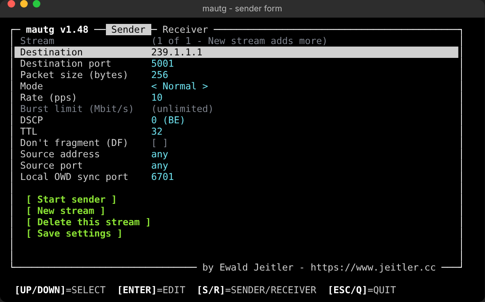
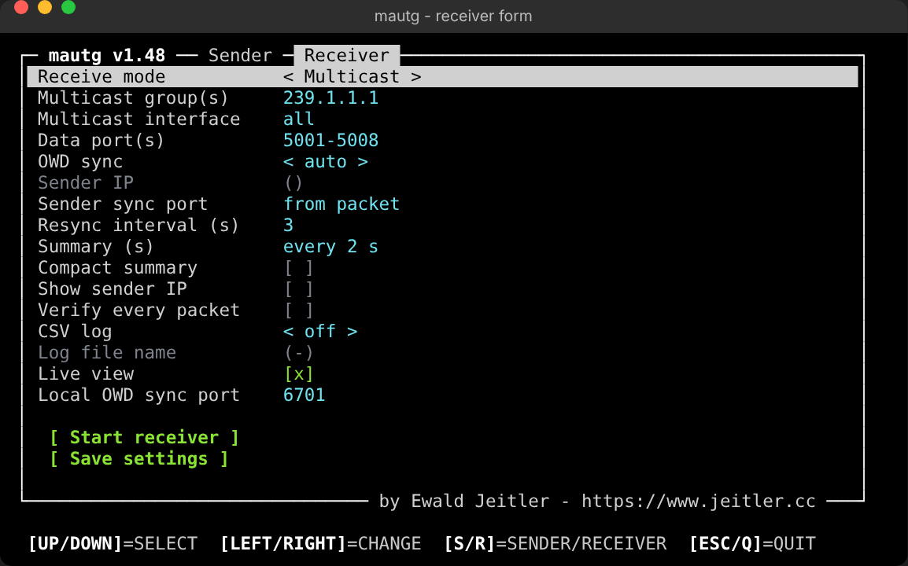
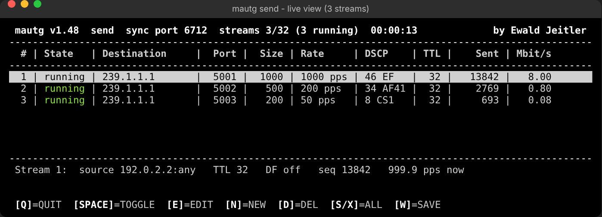
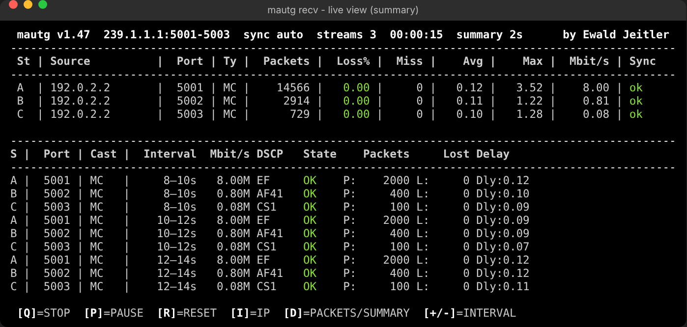
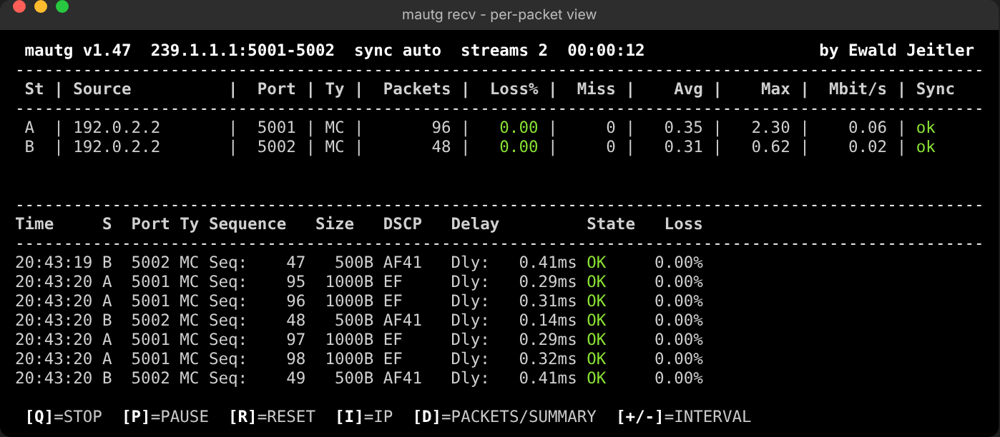
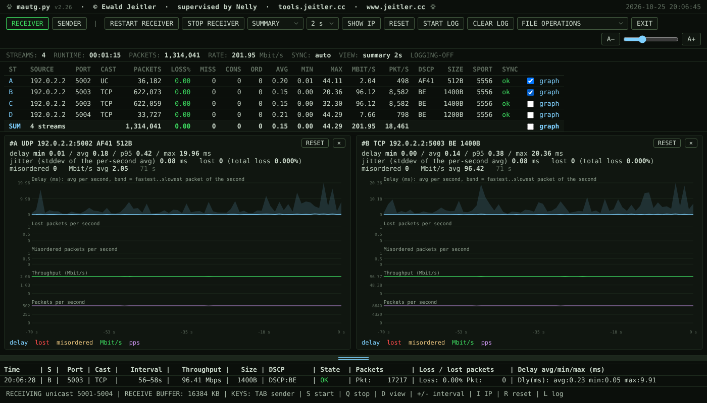
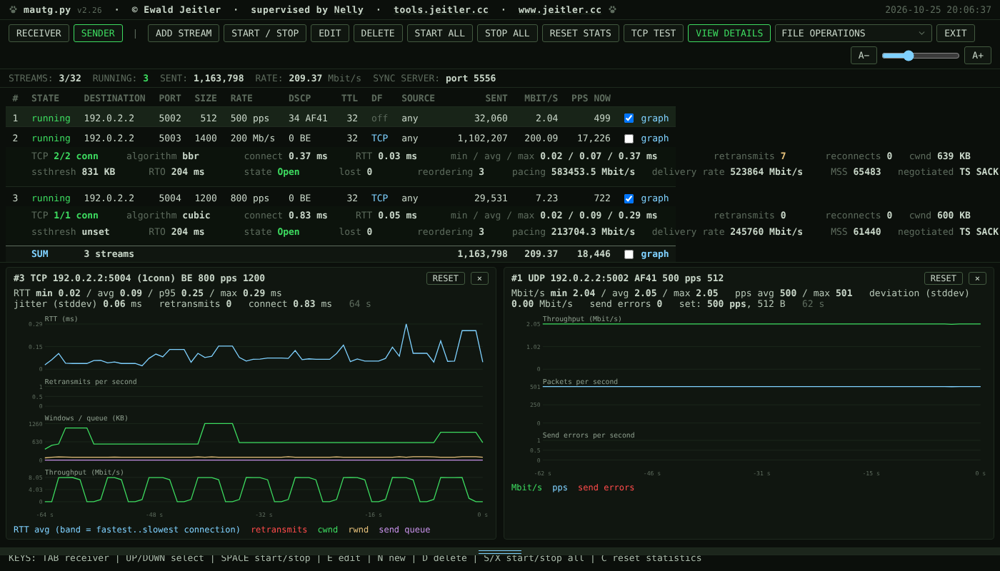

# MAU — Multicast/AND/Unicast Traffic Generator & Analyzer

Single-file Python tool (standard library only) for UDP and TCP traffic generation and analysis: one-way delay (OWD), loss, misorder, DSCP, throughput. Two roles, **sender** (`send`) and **receiver** (`recv`), started from a menu, by sub-command, or as web GUI.

By Ewald Jeitler - https://www.jeitler.cc

## Platform status

| Platform | Status |
|---|---|
| Linux (incl. Raspberry Pi OS) | Full function, main test platform |
| macOS | **Alpha** - hardly tested, reduced function (below) |
| Windows | **Alpha** - hardly tested, reduced function (below) |

- **macOS:** no kernel RX timestamps (delay stamped in user space), no per-socket drop counter (system-wide UDP counter only), no DF bit, TCP: algorithm system-wide, `TCP_CONNECTION_INFO` without windows / send queue.
- **Windows:** no kernel RX timestamps (delay stamped in user space), no RX-drop detection, lower maximum pps, sender DSCP only as administrator (QoS policy), TCP: algorithm system-wide, sender send buffer adds to the delay, no TCP DF.
- Launcher packages for both: [Windows / macOS](#windows--macos-launcher). Expect bugs; reports welcome.

## Features

- Multicast, unicast, broadcast; up to 32 sender streams, up to 36 receiver streams (key: source IP + sync port + destination port + stream id)
- OWD: NTP-style 4-timestamp sync, drift tracking, kernel RX timestamps (Linux)
- Per stream: loss, `Cons` (most packets lost in a row), misorder, duplicates, restart detection, DSCP, MC/UC/BC, Mbit/s, pkt/s, delay avg/min/max; `SUM` row over all streams
- TCP streams (parallel connections, per-message delay, kernel TCP statistics, congestion control, window/buffer settings, traffic patterns, slow reader, step / algorithm / bufferbloat tests), see [TCP](#tcp)
- Burst mode, DSCP, TTL, DF, source address/port
- Receiver overload detection (RX drops, display limit), CSV log, Wireshark dissectors
- Full-screen ANSI text UI with line-menu fallback; web GUI (`-web`) or web view of a terminal run (`-wv`, `-wvc`)
- Python 3.6.1+ (also Cisco IOS-XE Guest Shell)

## Installation / Update

```
/bin/bash -c "$(curl -fsSL https://raw.githubusercontent.com/ewaldj/mautg/main/e-install.sh)"
```

Installs `mautg.py` to `/usr/local/bin` as `mautg`; running it again updates. Manual: download `mautg.py` from https://github.com/ewaldj/mautg, `chmod +x mautg.py`. Windows / macOS: see [launcher](#windows--macos-launcher).

- Python 3.6.1+. Receiver cost per packet: 2.0 us (3.8), 1.3 us (3.11/3.13). Python 3.6 (Guest Shell): `python3 mautg.py`; not yet run on a real 3.6.
- Guest Shell sees only its own interface (`eth0` / VirtualPortGroup / AppGigabitEthernet); multicast needs PIM or IGMP join towards it; use low rates (a few thousand pps).
- Unicode only with a UTF-8 locale, else ASCII (`--ascii` / `MAUTG_ASCII=1`). Garbled `‚úì` = terminal decodes UTF-8 as Mac Roman: set the terminal encoding to UTF-8.

## Screenshots











## Quick Start

```bash
./mautg.py send -d 239.1.1.1 -p 5001 --pps 100      # sender (starts the sync server)
./mautg.py recv -g 239.1.1.1 -p 5001 -i 5           # receiver, summary every 5 s
./mautg.py                                          # menu
./mautg.py -web                                     # web GUI (default port 8081)
```

Without root in a terminal (Linux/macOS) mautg asks `Restart with sudo? [Y/n]`: root allows a receive buffer above the OS limit. `y` runs `sudo -v` and restarts through sudo; config stays in your own `~/.mau`. No question without terminal, as root, on Windows, or with `--no-sudo` / `MAUTG_NO_SUDO=1`. The receiver detects the sender from the first packet; delay values appear after the time sync (a few seconds).

## Menu (full-screen text UI)

Tabs **Sender** / **Receiver**; `[ Save settings ]` writes `~/.mau/config.json`.

| Key | Action |
|---|---|
| Up / Down | select row |
| Enter | edit row / run button (Esc cancel, Ctrl-U clear) |
| Space, Left / Right | toggle `[x]`, change `< choice >` |
| `s` / `r`, Tab | Sender / Receiver tab |
| Esc / q | leave (unsaved: Save & quit / Quit without saving / Cancel) |
| Ctrl+C | stop / quit at any time |

- Live views stop with `q` / Ctrl+C. Terminal at least 60x16, otherwise numbered line menus (sender: one stream). ANSI/VT100 only; `--no-color` / `NO_COLOR`, `--color`.
- Closing the terminal, SIGHUP, SIGTERM stop everything (exit 129 / 143); use `tmux` / `screen`.
- Source address list = IPv4 addresses of the host (also selects the multicast interface). DSCP list: BE, CS1-7, AF11-43, VA, EF, custom 0-63.
- TCP fields of a stream are shown only for Protocol TCP.

## Sub-command `send`

`send` without destination opens the sender menu; with destination it starts the live view (`--no-live` = plain output).

```bash
./mautg.py send -d 239.1.1.1 -p 5001 -s 1500 --pps 1000 --dscp 46   # constant rate
./mautg.py send -d 10.0.0.5 --burst                                  # burst, max speed
./mautg.py send -d 10.0.0.5 -s 1500 --burst --burst-mbps 200         # burst, 200 Mbit/s
./mautg.py send -d 172.17.17.255 -p 5001 --pps 50                    # broadcast
./mautg.py send -d 10.0.0.5 -s 1500 --pps 100 --df                   # DF bit (Linux)
./mautg.py send --stream 239.1.1.1:5001,pps=100,dscp=EF --stream 10.0.0.5:5003,tcp,conn=4,burst=200
```

### Streams (sender live view)

Up to 32 streams, one thread and one socket each, one shared sync server. The receiver separates streams by source IP + destination port: every stream needs its own port. Streams 2-32 are stored as `extra_streams`.

| Key | Action |
|---|---|
| Up / Down | select stream |
| Space | start / stop selected (sequence continues) |
| `s` / `x` | start / stop all |
| `c` | reset statistics (counters, graphs); streams keep running |
| `e` / Enter | edit (also while running; Left/Right/Tab = other stream) |
| `n` | new stream (copy, next free port) |
| `d` / Del | delete (y/n) |
| `w` | save streams to config |
| `r` | receiver view (starts the receiver with saved settings if none runs) |
| `q` / Ctrl+C | stop all (also the receiver) |

Rate column = measured over the last 0.5 s. Send errors: `ERROR` + reason, retried every 0.2 s.

`--stream DEST:PORT[,pps=N][,size=N][,dscp=N|NAME][,ttl=N][,burst[=MBIT]][,src=IP][,sport=N][,df][,tcp][,conn=N][,cc=NAME][,sndbuf=KB][,mss=N][,nagle][,on=S][,off=S][,recycle=S]`; unset values come from the other `send` options and the saved config. Without terminal or with `--no-live`: one stream prints plain output, several a status line every 5 s.

### Options (`send`)

| Option | Description |
|---|---|
| `-d`, `--destination` | Destination IP |
| `-p`, `--port` | Destination port (default 5001) |
| `-s`, `--size` | UDP: wire size in bytes (IP packet; payload = size - 28); TCP: message size |
| `--pps` | Packets (TCP: messages) per second |
| `--dscp` | DSCP 0-63 |
| `--ttl` | TTL 1-255 |
| `--source` | Source IP of this host (also selects the multicast interface). Set it for multicast/broadcast on multi-homed hosts (macOS Wi-Fi + LAN, VPN): otherwise the routing table decides (warning at start) |
| `--source-port` | Source port |
| `--burst`, `--burst-mbps` | Burst mode, limit in Mbit/s (0 = unlimited) |
| `--df` | DF bit (Linux; TCP: forces DF on the connection) |
| `--tcp` | TCP stream, see [TCP](#tcp) |
| `--connections N` | Parallel TCP connections (1-64, implies `--tcp`) |
| `--cc NAME` | TCP congestion control per connection (Linux), e.g. `cubic`, `reno`, `bbr` |
| `--sndbuf KB` | TCP send buffer (default: autotuning) |
| `--mss N` | TCP MSS (88-9000, default: system) |
| `--nagle` | TCP: Nagle on (default: `TCP_NODELAY`) |
| `--tcp-on S` / `--tcp-off S` | TCP: send for S s, then pause S s, repeated |
| `--tcp-recycle S` | TCP: reconnect every S s (sequence and stream identity continue) |
| `--stream SPEC` | Add stream (repeatable, max 32) |
| `--sync-port` | Local sync server port (default 5556) |
| `--no-sync-server` | No sync server |
| `--no-live` | Plain output |
| `-m`, `--menu` | Sender menu |
| `--no-tui`, `--no-color`, `--color`, `--ascii` | Output options |
| `-web`, `-wv`, `-wvc`, `-port`, `-bind` | [Web GUI](#web-gui) |

### Pacing and performance

2-core Linux VM, sender and receiver on one host, 200-byte packets: one stream burst max 303k pkt/s; four streams x 50k pps 94k pkt/s; receiver without loss (summary view) 200k pps, 1.3 us per packet.

- **One stream:** each packet at its due time (sleep until 0.5 ms before, then busy-wait on `perf_counter`); one core at 100 % above about 2000 pps. At 10k pps: median gap 100.0 us, 95 % below 103 us.
- **Several streams:** streams with interval below 1 ms sleep until due; late packets go back-to-back (max 64 per round). Average rate exact; spacing at 10k+ pps in groups of a few packets.
- **Burst:** as fast as the limit allows; a stream more than 1 s behind restarts its schedule.
- **Limit:** GIL, all streams together about 100-300k pps. Per-packet display (`-i 0`) and CSV log cost more than the summary view.

### Receiver overload (loss that is not network loss)

- **Display limit:** per-packet display max 500 lines/s (`--print-limit N`, 0 = off); all packets are counted. Status bar `DISPLAY LIMITED 500/S`.
- **Linux:** `SO_RXQ_OVFL` drop counter per packet; `RX OVERLOAD: n DROPPED LOCALLY` in status bar, summaries, final statistics.
- **macOS / BSD:** system-wide counter `dropped due to full socket buffers` (`netstat -s -p udp`, every 2 s; also counts other programs). Receive loop reads up to 32 datagrams per call with `recvmsg_x` (private libSystem call; self-test at start, `MAUTG_NO_RECVX=1` disables).
- **Any OS:** receive queue not empty for more than 1 s: `RX AT LIMIT`. Delay values are unreliable while overloaded.
- **Receive buffer:** requests up to 8 MB, the banner shows the granted size. Linux cap `net.core.rmem_max` (about 212 KB default on Raspberry Pi OS); root may exceed it (`SO_RCVBUFFORCE`).

```
sudo sysctl -w net.core.rmem_max=16777216                                   # until reboot
echo 'net.core.rmem_max=16777216' | sudo tee /etc/sysctl.d/99-mautg.conf     # permanent
sudo sysctl -w kern.ipc.maxsockbuf=8388608                                  # macOS
```

100k pps, 1000-byte packets: 416 KB buffer 1.0 % loss, 16 MB 0 %. A bigger buffer only absorbs short stalls; a permanently too slow receiver (about 150-250k pps per process) needs fewer packets or the summary view.

### Raspberry Pi 5 (direct 1 Gbit/s link)

Burst max, 1500-byte packets (975 Mbit/s, 81k pps = line rate), summary view: receiver takes about 65k pps (790 Mbit/s), loss 17-19 % (1/4 counted by the socket, 3/4 before it: NIC ring, kernel backlog), delay constant 85-95 ms (full queues). Reliable: 60k pps or less (about 700 Mbit/s at 1500 bytes); x86 PC 200k pps and more. `recvmmsg`: no gain; several receiver processes do not help for one stream. Untested checks: `ip -s link show eth0`, `ethtool -S eth0`, `/proc/net/softnet_stat`, `net.core.netdev_max_backlog=10000`, `taskset -c 3`.

## Sub-command `recv`

`recv` starts with its defaults and the given options (it does not read the saved menu config); `-m` opens the receiver menu. Live view on terminals of at least 80x16 (`--no-live` = scrolling output).

```bash
./mautg.py recv -g 239.1.1.1 -p 5001                  # summary every 2 s
./mautg.py recv -g 239.1.1.1 -p 5001 -i 0             # per packet
./mautg.py recv -g 239.1.1.1 -c 1                     # compact summary, 1 s
./mautg.py recv -u -p 5001 -i 2                       # unicast
./mautg.py recv -g 239.1.1.1 -i 10 -l capture.csv     # CSV log
./mautg.py recv -g 239.1.1.1 --sender 192.168.1.10 --sender-sync-port 5600
./mautg.py recv -g 239.1.1.1 --sender none            # no time sync
```

### Live view

- Status bar, stream table (Source, Port, Cast, Packets, Loss%, Miss, Cons, Ord, Avg/Min/Max, Mbit/s, pkt/s, DSCP, Size, SPort, Sync = `ok`/`wait`/`FAIL`/`none`/`off`), headline, scrolling log. Narrow terminals drop columns in this order: `Min`, `Ord`, `SPort`, `DSCP`, `Size`, `Miss` (full table about 110 columns); the table shows 2/4/8 streams by height.
- DSCP column = latest packet (`CS1*` = changed during the run).

| Key | Action |
|---|---|
| `s` | sender view (streams and receiver keep running) |
| `q` | stop the receiver (final statistics follow) |
| `e` | edit receiver settings; Apply restarts the receiver, statistics start from zero |
| `p` | pause log |
| `i` | show/hide sender IP |
| `r` | reset view (streams, counters, clock, RX OVERLOAD; sync and CSV keep running) |
| `d` | per-packet / summary |
| `+` / `-` | summary interval 1, 2, 3, 5, 10, 20, 30, 60 s |

### Line formats

```
18:16:01 | A | Seq:   946 | Size:  256 | DSCP:EF    | Delay:   0.25ms | OK    | Loss:  0.00%     (per packet, -i 0; stream label from the 2nd stream)
20:47:37 |      0–2s |  695.81 Mbps |  1500B | DSCP:BE    | OK     | Pkt:    58023 | Loss: 0.00% Pkt:     0 | Dly(ms): avg:0.42 min:0.33 max:0.55   (-i N)
      0–1s |    0.04 Mbps | BE    | OK   | Pkt:       21 | LPkt:      0 | Dly:0.29                                                          (-c N)
```

Summary values are per interval, one line per stream; Ctrl+C prints totals. `Delay:~` = negative reading floored to 0 for display; CSV keeps the raw value.

### Options (`recv`)

| Option | Description |
|---|---|
| `-I`, `--interface` | Multicast join interface: `all` (default), `auto`, IP or name |
| `-g`, `--group` | Multicast group(s): list / range / short range (default 239.1.1.1) |
| `-p`, `--port` | Port, range or list, e.g. `5005`, `5001-5008`, `5005,6000-6003` (default 5001-5008) |
| `-u`, `--unicast` | Unicast mode (bind to own IP) |
| `-i`, `--interval` | Summary interval in s (default 2; 0 = per packet) |
| `-c`, `--compact` | Compact summary interval in s (overrides `-i`) |
| `-l`, `--log` | CSV log in the current directory; without name `mautg-log_<date>_<time>.csv` |
| `--sender` | Sender IP for sync (default: auto-detect; `none` = no sync) |
| `--sender-sync-port` | Sync port of the sender (default: from packets; 5556 with `--sender`) |
| `--show-ip` | Sender IP in every line |
| `--no-tcp` | No TCP listeners (default: TCP accepted on the data ports) |
| `--tcp-rcvbuf KB` | TCP receive buffer of the listeners (limits the announced window; default: autotuning) |
| `--tcp-read-rate MBIT` | Slow reader: read at most MBIT Mbit/s |
| `--tcp-read-on S` / `--tcp-read-off S` | Slow reader: read for S s, then do not read for S s (zero window) |
| `--verify` | CRC + padding check of every packet (default: magic per packet, full check at lock-in) |
| `--print-limit N` | Max lines/s in per-packet display (default 500, 0 = unlimited) |
| `--resync-interval` | Resync interval in s (default 3) |
| `--sync-port` | Local sync server port (default 5556) |
| `--no-sync-server` | No sync server |
| `--no-live` | Scrolling output |
| `-m`, `--menu` | Receiver menu |
| `--no-tui`, `--no-color`, `--color`, `--ascii` | Output options |
| `-web`, `-wv`, `-wvc`, `-port`, `-bind` | [Web GUI](#web-gui) |

### Multicast

- **Interface (`-I`):** `all` joins every group on every IPv4 address except loopback (failing interfaces are skipped and listed in the banner; fatal only if none works; Linux limit 20 memberships per socket, `net.ipv4.igmp_max_memberships`); `auto` = kernel decides; IP / name = that interface only, errors fatal. Multicast arriving on two interfaces is one stream (duplicate counter).
- **Groups:** `-g 239.1.1.1,239.1.1.10` (list), `-g 239.1.1.1-239.1.1.10` (range), `-g 239.1.1.1-10` (short), combinable, max 16. Every port socket joins all groups; a stream is not tied to a group.
- **Cast:** per stream from the destination address of each datagram (`IP_PKTINFO` Linux/Windows, `IP_RECVDSTADDR` macOS/BSD): **MC** 224.0.0.0/4, **BC** 255.255.255.255 or directed `x.y.z.255` not local, **UC** otherwise; `--` = unknown; latest packet counts.

### Ports and streams

Default 5001-5008, one socket per port (max 512). Stream key = sender IP + advertised sync port + destination port (+ stream id); labels A-Z, 0-9 (max 36). With more than one port the `Port` column appears.

- **Detection:** first valid packet gives source IP and sync port; sync runs in a background thread; delay `n/a` until it succeeds (retry every 5 s); throughput and loss work without. With `--sender IP` only streams of that IP get delay.
- **Own-traffic check:** magic `MAUT` + version per packet; others are ignored and counted (`non-mautg`). CRC32 + padding at lock-in, per packet with `--verify`.
- **Tracker per stream:** highest sequence plus window of the last 2048; gap = lost, late arrival inside the window takes the loss back and counts as misorder, repeated sequence = `DUP` (not counted for loss). `Cons` = longest run of sequence numbers that never arrived.
- **Restart:** a new stream id on the same IP/port after the old one was silent (more than 4x the packet interval, at least 0.3 s) = restart (`Sender restart detected`, tracker starts over); a new id while the old one still arrives = second sender (own stream); packets of the replaced id are dropped and counted. An outage of the same running stream (same id) is loss, not restart.
- **Copies:** the same packet (timestamp + sequence) on two streams: `Copies of stream A: N` with arrival-time difference avg/min/max.
- **Firewall / NAT:** UDP from receiver to the sender's sync port (5556) must be allowed; otherwise no delay (`--sender none`).

### Delay measurement

1. Warmup: 3 requests, discarded; none answered = sync server unreachable.
2. Initial sync: 16 samples, clock filter (median/MAD outlier rejection, then lowest RTT).
3. Resync every 3 s (`--resync-interval`), 8 samples per round.
4. Between resyncs the offset is extrapolated with a tracked linear drift.
5. Linux: kernel RX timestamps (`SO_TIMESTAMPNS`) for sync and data; elsewhere `time.time_ns()`.

Accuracy is limited by path symmetry: offset error is about half the asymmetry. Negative readings: floored to 0 on screen (`~`), raw in CSV.

## TCP

`--tcp`, `--stream "10.0.0.5:5001,tcp,conn=4"` or field *Protocol* in the forms. The receiver listens on every data port with TCP too (`--no-tcp` / *TCP listener* off) and shows every connection as its own stream (cast `TCP`).

- **Framing:** after connect a 16-byte hello (`MTCP`, version, DSCP, message size), then fixed-size messages in the data packet format ([Protocol](#protocol)). `--size` = message size (55 - 1048576 bytes), not wire size.
- **Rate:** `--pps` / burst values are the total of the stream, shared by its connections; burst without limit = as fast as TCP allows.
- **Delay:** sender timestamp until the receiver reads the message (user space), normal OWD sync. The sender stamps a message right before writing (16 KB chunks) and keeps its own queue short (`TCP_NOTSENT_LOWAT` 32 KB, Linux/macOS), so delay shows the path (queues, retransmissions, small cwnd). TCP delivers in order, so the receiver shows no loss values for TCP streams (`-` in table and lines, no lost / misordered graphs); retransmits show as delay and in the TCP values.
- **DSCP:** set on the sender socket; the receiver reads it from the SYN (Linux), otherwise from the hello.
- **Limits:** unicast only; a lost connection is re-established every 0.5 s (counted as reconnects); the receiver shows no TCP statistics.

### Settings per stream

| Setting | Notes |
|---|---|
| connections | 1-64, rate shared |
| congestion control | `TCP_CONGESTION` per connection (Linux: `cubic`, `reno`, `bbr`, ...); macOS/Windows system-wide |
| send buffer | `SO_SNDBUF` in KB; small buffer limits the window to buffer / RTT |
| MSS | `TCP_MAXSEG` |
| no-delay | off = Nagle |
| DF | Linux |
| send for / then pause (s) | burst / pause pattern; idle connection shows slow start restart |
| reconnect every (s) | close and reconnect; slow start each time; sequence and stream id continue |

Receiver (settings dialog, TUI, CLI): receive buffer (`--tcp-rcvbuf`) and **slow reader** (`--tcp-read-rate`, `--tcp-read-on` / `--tcp-read-off`): the receiver reads at most the given rate and / or pauses reading; data stays in the kernel buffer, the announced window shrinks to zero (sender `rwnd 0 KB`). Applied with a receiver restart.

### TCP values (sender)

Per stream: connections up, connect time, RTT (now, min/avg/max of the run), retransmits, reconnects; `VIEW DETAILS` adds cwnd, rwnd, send queue and a second line: ssthresh (`unset` = no loss yet), RTO, state (Open/Disorder/CWR/Recovery/Loss), lost, reordering, pacing, delivery rate, MSS, negotiated options (TS, SACK, WS, ECN). Zero values are shown. Every value has a mouse-over text. Sources: `TCP_INFO` (Linux, all values), `TCP_CONNECTION_INFO` (macOS, no windows/queue), `SIO_TCP_INFO` (Windows 10+).

### TCP test (web GUI, `TCP TEST`)

Changes one setting of the selected TCP stream step by step (warm-up, then measurement per step) and restores the stream afterwards; one test at a time, `STOP` restores at once.

| Test | Steps |
|---|---|
| connections | e.g. `1,2,4,8` or `1-8/1` |
| rate limit | Mbit/s in burst mode, `0` = unlimited |
| algorithm comparison | Linux, `default` = system default |
| bufferbloat | two phases on fresh connections: idle (1 packet/s) and under load (stream setting or load rate); shows idle RTT, RTT under load, added delay (avg, p95) |

Table per step: Mbit/s (avg/min/max), RTT (avg/p95/max), retransmits, retransmit %, cwnd, worst state. `SAVE` downloads a CSV (nothing is written automatically). Sender-side values only.

## Web GUI





| Option | Effect |
|---|---|
| `-web` | Web GUI instead of the terminal UI: sender (up to 32 streams) and receiver run and are edited in the browser. `send ... -web` / `recv ... -web` start streams / receiver with the given options |
| `-wv` | Terminal run plus read-only web view |
| `-wvc` | Like `-wv`, the browser can also control the run |
| `-port N`, `--web-port N` | HTTP port (default 8081); `-p` of `recv` is the data port |
| `-bind ADDR` | Bind address (default `0.0.0.0`) |

- Page polls `/api/status` once per second; commands go to `POST /api/command` and run in the thread that owns the receiver / streams. The page reloads itself when mautg restarts (also with another version). No authentication, no TLS: `-bind 127.0.0.1` (e.g. with an SSH tunnel). Exit in the browser stops the program. Only one receiver per program (a start while one runs is refused).
- **Receiver tab:** stream table, log (download; START LOG / STOP LOG writes a CSV), settings dialog (same fields as the receiver form). Click on ST or SOURCE marks the lines of that stream in the live view (own colour per stream, second click removes).
- **Sender tab:** stream table with `SUM` row, add / edit dialog (TCP fields only for TCP), `VIEW DETAILS`, `RESET STATS`, `TCP TEST`; TCP values below each stream row (two lines).
- **FILE OPERATIONS:** download CSV log, log text, config (`mautg-config.json`); download / upload / delete files of the working directory (upload max 16 MB, several downloads = ZIP); SAVE CONFIG; LOAD CONFIG FROM SERVER / upload a `.json` (validated, saved, activated; LOAD restarts what ran, LOAD & RUN starts all streams and the receiver).
- **Keys:** `Tab` receiver/sender. Receiver: `s` start, `q` stop, `d` summary/per packet, `+`/`-` interval, `i` IP, `r` reset, `l` log. Sender: Up/Down/Home/End, `Space` start/stop, `e`/Enter edit, `n` new, `d`/Del delete, `s`/`x` all, `c` reset statistics. Dialogs: Enter = first button, Esc = cancel.
- **Graphs:** `graph` checkbox per row (also `SUM`); last 15 min, one value per second, collected in the background; several graphs side by side; the divider below the graph area is draggable (height remembered, double-click = default). Title `#no. protocol ip:port (conns) DSCP rate size` (receiver `#A protocol ip:port DSCP size`); the mouse-over tooltip stays until the mouse moves, is clicked or leaves. Receiver: delay (avg, band min..max), lost / misordered per second, Mbit/s, pps. Sender UDP: Mbit/s, pps, send errors. Sender TCP: RTT (band fastest..slowest connection), retransmits per second, cwnd / rwnd / send queue, throughput, summary min/avg/p95/max and jitter. RESET on a graph clears that stream; receiver RESET / sender RESET STATS clear all.
- Sender errors (send error, TCP reconnect) show for about 8 s; a stream that stopped on an error keeps its message. `RX OVERLOAD` stays until the receiver reset.
- Server gone: dialog MAUTG.PY STOPPED; the page reloads when mautg is back. `-wv`/`-wvc`: terminal status bars show `web :PORT` (`ro` = read only). `-wvc` without `send`/`recv`: text menu in the terminal, everything also in the browser.

## Protocol

Data packet (format version 2), all fields big-endian:

```
 0                   1                   2                   3
 0 1 2 3 4 5 6 7 8 9 0 1 2 3 4 5 6 7 8 9 0 1 2 3 4 5 6 7 8 9 0 1
+-+-+-+-+-+-+-+-+-+-+-+-+-+-+-+-+-+-+-+-+-+-+-+-+-+-+-+-+-+-+-+-+
|                      Sequence Number (32)                     |
+-+-+-+-+-+-+-+-+-+-+-+-+-+-+-+-+-+-+-+-+-+-+-+-+-+-+-+-+-+-+-+-+
|                   Timestamp in µs (64)                        |
|                    CLOCK_REALTIME                             |
+-+-+-+-+-+-+-+-+-+-+-+-+-+-+-+-+-+-+-+-+-+-+-+-+-+-+-+-+-+-+-+-+
|                        Magic "MAUT" (32)                      |
+-+-+-+-+-+-+-+-+-+-+-+-+-+-+-+-+-+-+-+-+-+-+-+-+-+-+-+-+-+-+-+-+
| Version (8)   |       Sender OWD Sync Port (16)               |
+-+-+-+-+-+-+-+-+-+-+-+-+-+-+-+-+-+-+-+-+-+-+-+-+-+-+-+-+-+-+-+-+
|                      Stream ID (32)                           |
+-+-+-+-+-+-+-+-+-+-+-+-+-+-+-+-+-+-+-+-+-+-+-+-+-+-+-+-+-+-+-+-+
|                      Padding (variable)                       |
|   "mautg_trafficgen_www.jeitler.cc:" + 0x2A fill             |
+-+-+-+-+-+-+-+-+-+-+-+-+-+-+-+-+-+-+-+-+-+-+-+-+-+-+-+-+-+-+-+-+
|                          CRC32 (32)                           |
+-+-+-+-+-+-+-+-+-+-+-+-+-+-+-+-+-+-+-+-+-+-+-+-+-+-+-+-+-+-+-+-+
```

| Field | Offset | Size | Format | Description |
|---|---|---|---|---|
| Sequence | 0 | 4 | uint32 | Counter, starts at 0 |
| Timestamp | 4 | 8 | uint64 | µs since Unix epoch |
| Magic | 12 | 4 | ASCII | `MAUT` |
| Version | 16 | 1 | uint8 | 2 |
| Sync port | 17 | 2 | uint16 | Sync server port of the sender (0 = none) |
| Stream ID | 19 | 4 | uint32 | Random, new at every start of a stream |
| Padding | 23 | variable | bytes | `mautg_trafficgen_www.jeitler.cc:` if it fits, then `0x2A` |
| CRC | last 4 | 4 | uint32 | CRC-32 (zlib) over all preceding bytes |

Minimum UDP payload 27 bytes (55 on the wire). `--size` is the wire size (IP packet); UDP payload = size - 28 (1500 gives 1472). Maximum with DF set = MTU of the way to the destination (Linux: kernel route MTU; macOS: MTU of the interface owning the local address, from `ifconfig`); if it cannot be determined, 65507. With DF off the maximum is 65507 (the packets are fragmented). macOS/BSD: additionally limited by `net.inet.udp.maxdgram` (default 9216 -> 9244 on the wire; `sudo sysctl -w net.inet.udp.maxdgram=65535` raises it), otherwise the send fails with `Errno 40 Message too long`. The sender table shows DF (on/off). Checked in the dialogs and with `-s`; a loaded config is not checked against the MTU.

### OWD time sync protocol

UDP, default port 5556, one server per process.

```
Receiver                          Sender
   |--- REQ {t1_ns} ------------->|  T1: receiver TX
   |                              |  T2: sender RX
   |<-- RSP {t1,t2,t3_ns} --------|  T3: sender TX
   |                              |  T4: receiver RX
```

```
RTT    = (T4 - T1) - (T3 - T2)
Offset = ((T2 - T1) + (T3 - T4)) / 2
OWD    = receiver_now - sender_timestamp + offset
```

| Message | Size | Layout |
|---|---|---|
| Request | 9 | `!B` type 0x01, `!Q` t1_ns |
| Response | 25 | `!B` type 0x02, `!Q` t1_ns, `!Q` t2_ns, `!Q` t3_ns |

Wrong size or unknown type: discarded.

### Several instances on one host

Each instance binds its own sync server: give each its own `--sync-port` (and data `-p`) or use `--no-sync-server` on all but one; otherwise they share port 5556 (`SO_REUSEADDR`) and only one answers. Receivers get the sync port from the packets.

## Configuration and logs

- Menu settings: `~/.mau/config.json`.
- CSV (`recv -l [name]`): current directory; default name `mautg-log_YYYY-MM-DD_HH:MM:SS.csv` (Windows: `-` instead of `:`); absolute paths as given.
- CSV columns: `Timestamp, Seq, Delay_us, DSCP, DSCP_Name, Status, Stream, Source_IP, Sync_Port, Port, Cast, Dest_IP` (Delay_us = raw one-way delay in whole microseconds, unclamped; Dest_IP = multicast group, broadcast or the unicast address it was received on).

## Wireshark

[mau_protocol.lua](wireshark/mau_protocol.lua) (data packets, UDP 5001-5008) and [mau_owd_sync_protocol.lua](wireshark/mau_owd_sync_protocol.lua) (sync, UDP 5556). See the [Wireshark README](wireshark/README.md).

## Examples

```bash
# QoS check: EF marking, delay and loss at the receiver
./mautg.py send -d 239.1.1.1 -s 1500 --pps 1000 --dscp 46
./mautg.py recv -g 239.1.1.1 -i 5

# Link stress: 500 Mbit/s with 1500-byte packets
./mautg.py send -d 10.0.0.5 -s 1500 --burst --burst-mbps 500

# Asymmetry: measure both directions
hostA$ ./mautg.py send -d 10.0.0.2 --pps 10 ; hostB$ ./mautg.py recv -u -i 10
hostB$ ./mautg.py send -d 10.0.0.1 --pps 10 ; hostA$ ./mautg.py recv -u -i 10

# Subnet broadcast
./mautg.py send -d 172.17.17.255 -p 5001 -s 256 --pps 10

# TCP: 4 connections with BBR, 2 s send / 3 s pause; receiver reads at 50 Mbit/s
./mautg.py send --stream 10.0.0.5:5001,conn=4,cc=bbr,burst=0,on=2,off=3
./mautg.py recv -u -p 5001 --tcp-read-rate 50
```

## Project structure

```
├── mautg.py              # sender + receiver + OWD sync server
├── e-install.sh          # installer / updater (Linux/macOS)
├── mversions             # versions for the launcher update check
├── Windows_Version/      # launcher + installer + portable zip (Windows, alpha)
├── OSX_Version/          # launcher + installer + portable zip (macOS, alpha)
├── src/                  # Go sources of launchers/installers, build.sh
├── screenshots/
├── wireshark/            # Lua dissectors + README
├── LICENSE
└── README.md
```

## Windows / macOS (launcher)

**Alpha status:** hardly tested, reduced function compared to Linux (see [Platform status](#platform-status)).

Packages with launcher window, bundled Python and update check are in `Windows_Version/` and `OSX_Version/` (details: `README.md` there). The launcher starts `mautg.py -web -bind 127.0.0.1` in the background, opens the web GUI and offers Start / Stop / Restart, web port, Console log, Update, Admin / Admin setup, Exit. Extra mautg options: `mautg-args.txt`. Terminal UI, `-wv`, `-wvc` are not available through the launcher.

| Platform | Installer | Portable |
|---|---|---|
| Windows 10/11 x64 | `Windows_Version/mautg-installer.exe` | `Windows_Version/mautg-windows.zip` |
| macOS 10.13+ (arm64 / x86_64) | `OSX_Version/mautg-installer-mac.zip` | `OSX_Version/mautg-mac.zip` |

- **Update:** the launcher compares `mversions` on GitHub (`mautg.py`, `mautg-windows`, `mautg-mac`) at start and every 6 hours. Build: `src/build.sh` (Go, cross compile; Python runtimes from `src/runtime/`).
- **Windows:** receiver DSCP and MC/UC/BC from `WSARecvMsg` (ctypes, Windows 10+); no kernel RX timestamps, no RX-drop detection, lower maximum pps. Sender DSCP only as administrator (QoS policy per stream, removed at exit; the launcher asks at start).
- **macOS:** the launcher can raise `net.inet.udp.maxdgram` and allow the bundled Python in the firewall (password prompt; mautg itself never runs as root). Apps are not signed / notarized: `OSX_Version/README.md`.
